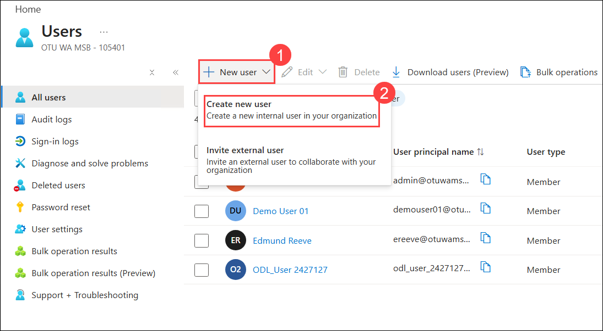
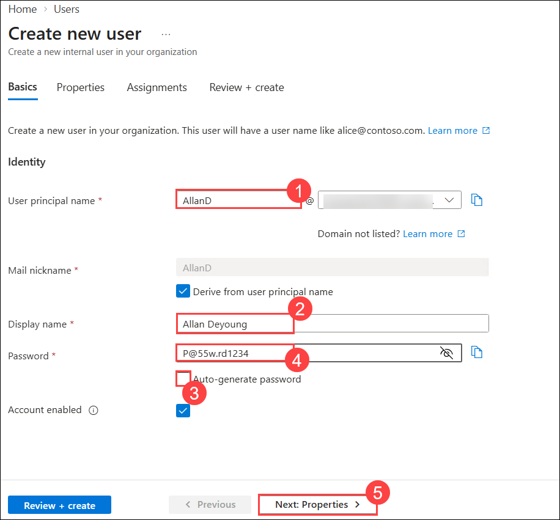
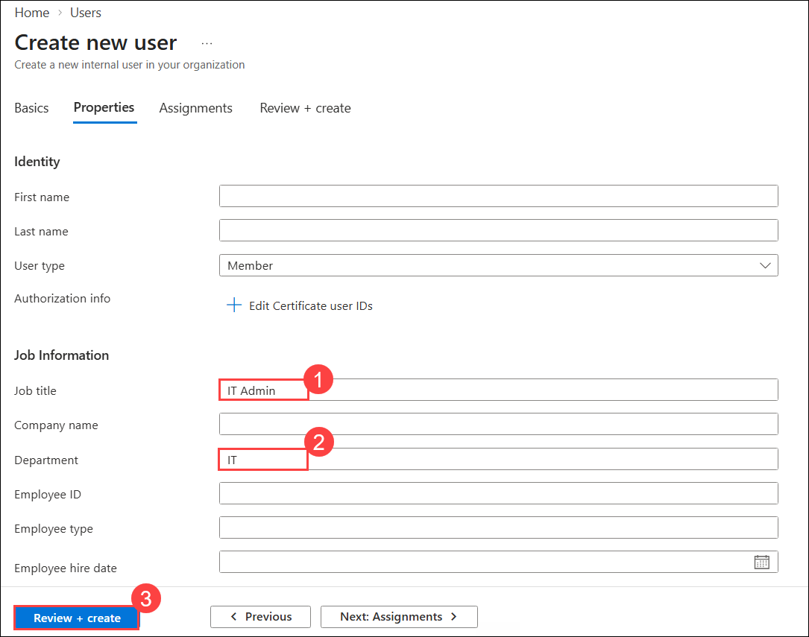
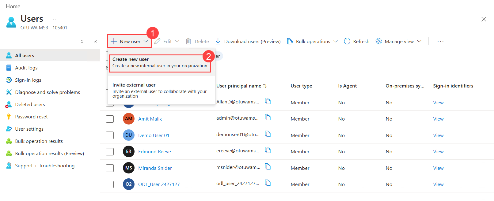
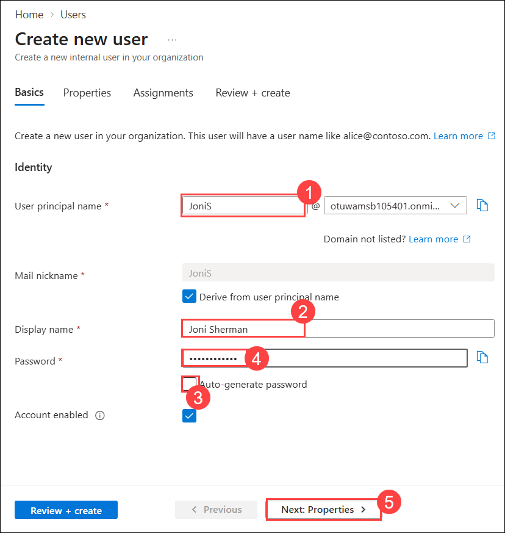
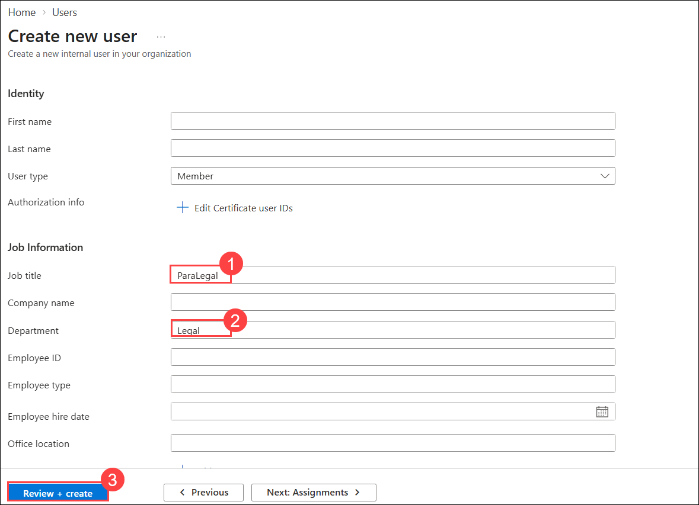
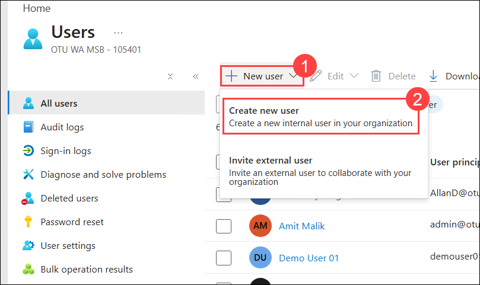
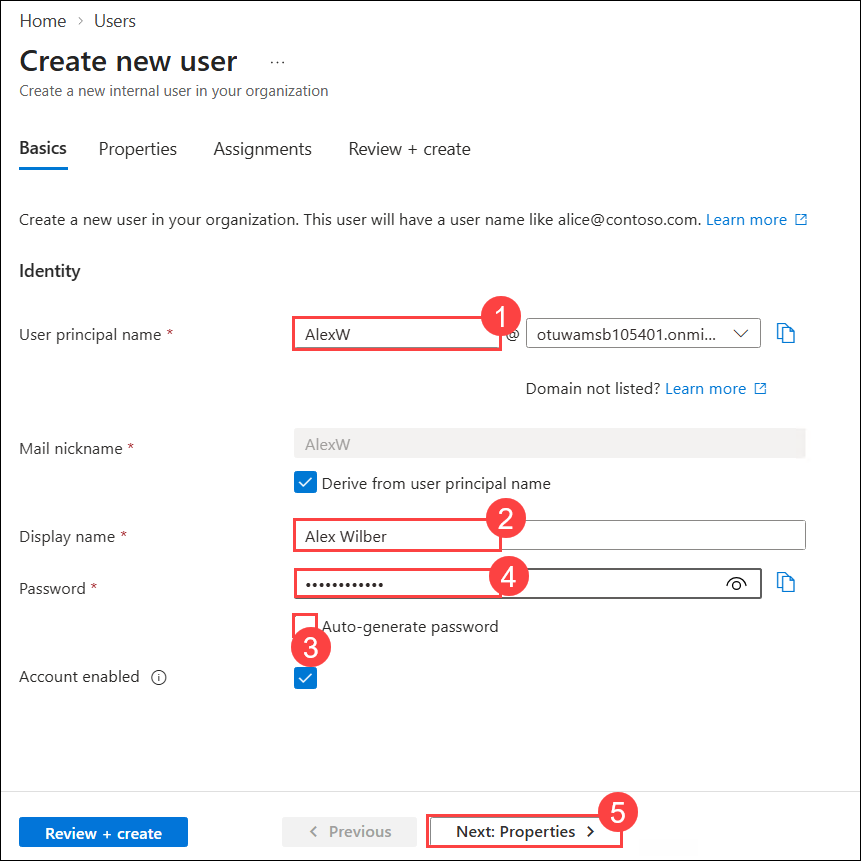
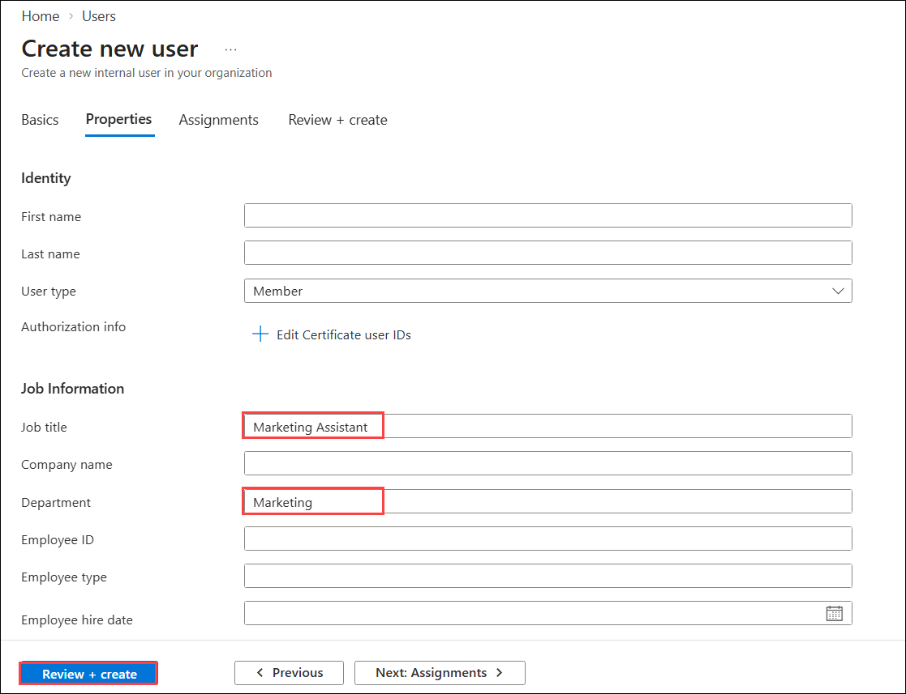

# Lab 1 - Set up Microsoft Intune

### Summary

In this lab, you will use the Microsoft Intune admin center to create and modify users, assign administrative roles, create and modify groups, and manage license assignments in Microsoft Entra ID.

## Exercise 1: Creating users in Microsoft Intune admin center

### Scenario

You need to create user accounts in Microsoft Intune admin center for some new employees that will start next week. New users are listed in the following table:

| **Name** | **User Name** | **Password** | **Job title** | **Department** |
|----------------|------------------------------------------------------------------------|--------------|------------------|----------------|
| Edmund Reeve | **ereeve@M365x27131290.onmicrosoft.com** | Pa55w.rd | HR Rep | HR |
| Miranda Snider | **msnider@M365x27131290.onmicrosoft.com** | Pa55w.rd | Helpdesk Manager | Operations |
| Cody Godinez | **cgodinez@M365x27131290.onmicrosoft.com** | Pa55w.rd | Sales Rep | Sales |

**Note**: For location use either your local region or United States.

You've also been told that several more employees will be hired over the next couple of months. You've decided that scripting would be a far more efficient method of adding a large number of new users. You've decided to create a PowerShell script and test it out when you create Cody Godinez's account.

### Task 1: Create users by using the Microsoft Intune admin center

1. On SEA-SVR1, sign in as Contoso\Administrator with the password of **Pa55w.rd**.

2. Login to <https://Intune.microsoft.com>.

    

3. From the left navigation pane, click on Users to create new users.

    

     

    > **Note:** Take note of the users that already exist as members. Each user is enabled as indicated on the Account enabled column. The On-premises synced enabled column states No for all current users. This indicates that each user was created directly and is not synchronized from an on-premises directory service.

4. On the **Users \| All users** page, select **New user** then select **Create new user**.

    

5. On the New User page, ensure that Create user is selected, enter the following:

    - User principal name: **ereeve**
    - Display name: **Edmund Reeve**
    - Uncheck **Auto-generate password**
    - Password: **P@55w.rd1234**

    

6. On the Properties tab, provide the below information and then click on Next Assignments.

    - Job title: **HR Rep**
    - Department: **HR**
    - Usage location: **United States**

    

7. On the Assignments tab, click on Review + create button. Then Verify the details then click on the **Create** button.

    

8. Similarly create the user account for Miranda Snider with the below details.

    - User principal name: **msnider**

    - Display Name: **Miranda Snider**

    - Uncheck Auto-generate password.

    - Password: **P@55w.rd1234**

    - Job title - **Helpdesk Manager**

    - Department: **Operations**

    - Usage location: United States

      

1. On the **Users** page, select **+ New user** **(1)**, and then select **Create new user** **(2)**.

   

1. On the **Basics** tab of the **Create new user** page, enter the following details, and then select **Next: Properties** **(5)**:

   - **User principal name:** Enter **AllanD** **(1)**
   - **Display name:** Enter **Allan Deyoung** **(2)**
   - **Auto-generate password:** Clear the checkbox **(3)**
   - **Password:** Enter **P@55w.rd1234** **(4)**

   

1. On the **Properties** tab, enter the following details, and then select **Review + create** **(3)**:

   - **Job title:** Enter **IT Admin** **(1)**
   - **Department:** Enter **IT** **(2)**
   - **Usage Loacation** Enter **United states (3)**

     

1. On the **Review + create** tab, select **Create**.

1. Back on the **Users** page, select **+ New user** **(1)**, and then select **Create new user** **(2)** to create the second user.

   

1. On the **Basics** tab, enter the following details, and then select **Next: Properties** **(5)**:

   - **User principal name:** Enter **JoniS** **(1)**
   - **Display name:** Enter **Joni Sherman** **(2)**
   - **Auto-generate password:** Clear the checkbox **(3)**
   - **Password:** Enter **P@55w.rd1234** **(4)**

     

1. On the **Properties** tab, enter the following details, and then select **Review + create** **(3)**:

   - **Job title:** Enter **ParaLegal** **(1)**
   - **Department:** Enter **Legal** **(2)**
   - **Usage Loacation** Enter **United states (3)**

     

1. On the **Review + create** tab, select **Create**.

1. Back on the **Users** page, select **+ New user** **(1)**, and then select **Create new user** **(2)** to create the third user.

    

1. On the **Basics** tab, enter the following details, and then select **Next: Properties** **(5)**:

   - **User principal name:** Enter **AlexW** **(1)**
   - **Display name:** Enter **Alex Wilber** **(2)**
   - **Auto-generate password:** Clear the checkbox **(3)**
   - **Password:** Enter **P@55w.rd1234** **(4)**

     

1. On the **Properties** tab, enter the following details, and then select **Review + create**:

   - **Job title:** Enter **Marketing Assistant**
   - **Department:** Enter **Marketing**
   - **Usage Loacation** Enter **United states (3)**

     

1. On the **Review + create** tab, select **Create**.

### Task 2: Create users by using PowerShell

1. On **SEA-SVR1**, on the taskbar, right-click **Start**, and then select **Windows PowerShell (Admin)**.

    

2. In the **Windows PowerShell** window, type the following command, and then press **Enter**. If prompted, enter **Y** at the NuGet and repository messages:

    ```powershell
    Install-Module Microsoft.Graph -Scope CurrentUser
    ```

    

    

3. In the **Windows PowerShell** window, type the following command, and then press **Enter**:

    ```powershell
    Connect-MgGraph -Scopes "Directory.ReadWrite.All","User.ReadWrite.All","Group.ReadWrite.All","RoleManagement.ReadWrite.Directory","Policy.ReadWrite.Authorization","Application.ReadWrite.All","offline_access"
    ```

4. Select **Work or school account**.

    

5. Click **Yes**.

    

    

6. In the **Sign in to your account** dialog box, sign in using the Office 365 Tenant credentials from the Home tab.

    > **Note:** If you had been prompted to change the Tenant admin credentials password, ensure to provide the updated password.

7. In the **Windows PowerShell** window, type the following code to create a new user, and then press **Enter**.

    > **Note:** Paste the below command in Notepad and substitute the tenant details, then copy and paste the command into Windows PowerShell to ensure the tenant information is correct.

    ```powershell
    New-MgUser -UserPrincipalName "cgodinez@M365xXXXXXXXX.onmicrosoft.com" -DisplayName "Cody Godinez" -GivenName "Cody" -Surname "Godinez" -MailNickname "cgodinez" -PasswordProfile @{ Password="P@55w.rd1234"; ForceChangePasswordNextSignIn=$false } -AccountEnabled:$true -UsageLocation "US" -JobTitle "Sales Rep" -Department "Sales"
    ```

    

8. In the **Windows PowerShell** window, type the following commands to reset the passwords of Alex Wilber, Allan Deyoung and Joni Sherman:

    ```powershell
    Connect-MgGraph -Scopes "User.ReadWrite.All","Directory.ReadWrite.All","Directory.AccessAsUser.All"
    ```

    

    ```powershell
    Get-MgUser -Filter "displayName eq 'Alex Wilber'" |
    ForEach-Object {
        Update-MgUser -UserId $_.Id -PasswordProfile @{
            Password = "P@55w.rd1234"
            ForceChangePasswordNextSignIn = $false
        }
    }
    ```

    ```powershell
    Get-MgUser -Filter "displayName eq 'Allan Deyoung'" |
    ForEach-Object {
        Update-MgUser -UserId $_.Id -PasswordProfile @{
            Password = "P@55w.rd1234"
            ForceChangePasswordNextSignIn = $false
        }
    }
    ```

    ```powershell
    Get-MgUser -Filter "displayName eq 'Joni Sherman'" |
    ForEach-Object {
        Update-MgUser -UserId $_.Id -PasswordProfile @{
            Password = "P@55w.rd1234"
            ForceChangePasswordNextSignIn = $false
        }
    }
    ```

    

9. In the **Windows PowerShell** window, type the following command, and then press **Enter**:

    ```powershell
    Get-MgUser -All -Property "displayName,userPrincipalName,assignedLicenses" |
      Select-Object DisplayName, UserPrincipalName, @{N='IsLicensed';E={ $_.AssignedLicenses.Count -gt 0 }} |
      Format-Table -AutoSize
    ```

10. Verify that the list of users from your tenant is displayed. Also take note of which users have a license assigned. Any user with the **isLicensed** value of **False** has not been assigned a license.

    

**Results**: After completing this exercise, you will have successfully created new user accounts in Microsoft Intune admin center.

## Exercise 2: Assigning Administrative Roles in Microsoft Entra ID

### Scenario

You need to review and modify the current administrative roles for your tenant.

You have been provided a list of users should have administrative roles assigned as indicated in the following table.

| **Name** | **Must be able to:** | **Administrative Role needed:** |
|----------------|------------------------------------------|---------------------------------|
| Allan Deyoung | Manage the tenant | Global administrator |
| Edmund Reeve | Manage users, group, and password resets | User administrator |
| Miranda Snider | Manage password resets | Helpdesk administrator |

### Task 1: Review and Assign Administrative Roles

1. On **SEA-SVR1**, switch to **Microsoft Edge**.

2. In the **Microsoft Entra admin center**, in the Navigation pane, expand **Entra ID.**

3. Select **Roles & admin** and search for **Global administrator** and click on the Role **Global Administrator**.

    

4. Click on **Add assignments**.

    

5. On the Add assignments page, under Select member(s) click on No member selected.

    

6. select **Allan Deyoung** and then click **Select**.

    

7. Click **Next**

    

8. On the Add assignment page, select assignment type as **Active** and enter justification as **Role Assignment** and click **Assign.**

    

9. At the top of the page, in the navigation link, select **Roles and administrators**.

    

10. On the **Roles and administrators** page, search and select **User administrator**. Ensure that **Assignments** is selected.

    

    Notice that there are no users currently assigned to the User administrator role.

11. Click on + **Add assignments**.

    

12. On the Add assignments page, click on No member selected and select **Edmund Reeve** .

    

    

13. On the Add assignments page, select the assignment type as **Active**, enter justification as **Role assignment** and click **Assign**.

    

14. Click on **Roles and administrators** link, then search and select **Helpdesk administrator**.

    

    

    Notice that there are no users currently assigned to the Helpdesk administrator role.

15. On the **Helpdesk administrator \| Assignments** page, select **Add assignments**.

    

16. On the Add assignments page, On the Add assignments page, click on No member selected and select **Miranda Snider**

    

    

17. On the Add assignments page, select the assignment type as **Active**, enter justification as **Role assignment** and click **Assign**.

    

18. At the top of the page, in the navigation link, select **Roles and administrators**.

    

**Results**: After completing this exercise, you should have successfully assigned administrative roles to users.

## Exercise 3: Creating and managing groups and validating license assignment.

### Scenario

You need to add the three new users to a Security group and assign licenses as indicated in the following table.

| **Name** | **Member of:** | **License to assign** |
|----------------|------------------|--------------------------------------------------------------------------|
| Edmund Reeve | Contoso_Managers | Enterprise Mobility + Security E5 via group membership |
| Miranda Snider | Contoso_Managers | Enterprise Mobility + Security E5 via group membership |
| Cody Godinez | Contoso_Sales | Enterprise Mobility + Security E5 via group membership direct assignment |

You have also been asked to modify the Company branding for the sign-in page.

### Task 1: Create groups by using the Microsoft Entra admin center

1. On **SEA-SVR1**, in the **Microsoft Intune admin center**, in the navigation pane, select **Groups** and then click on **New group.**

    

2. On the **New Group** page, enter the following:

    - Group type: **Security**

    - Group name: **Contoso_Managers**

    - Membership type: **Assigned**

3. Under Members, click on **No members selected**.

4. In the Add members page add **Edmund Reeve**, **Miranda Snider**, **Miriam Snider** and then click **Select**.

    

5. Select **Create**.


### Task 2: Create groups by using PowerShell

1. On **SEA-SVR1**, switch to Windows PowerShell.

2. In the **Windows PowerShell** window, type the following code to create a new group, and then press **Enter**:

    ```powershell
    New-MgGroup -DisplayName "Contoso_Sales" -Description "Contoso Sales team users" -MailEnabled:$false -MailNickname "Contoso_Sales" -SecurityEnabled:$true
    ```

    

3. In the **Windows PowerShell** window, type the following command, and then press **Enter**:

    ```powershell
    Get-MgGroup -All
    ```

    

4. Verify that you get the list of groups in your tenant, including the **Contoso_Sales** group you just created.

    

5. In the **Windows PowerShell** window, type the following code to define a variable as the Contoso_Sales group, and then press **Enter**:

    ```powershell
    $group = Get-MgGroup -Filter "displayName eq 'Contoso_Sales'"
    ```

    

6. In the **Windows PowerShell** window, type the following code to define another variable as the user, and then press **Enter**:

    ```powershell
    $user = Get-MgUser -Filter "displayName eq 'Cody Godinez'"
    ```

    

7. In the **Windows PowerShell** window, type the following code to add Cody to Contoso_Sales using the variables you set, and then press **Enter**:

    ```powershell
    New-MgGroupMemberByRef -GroupId $group.Id -BodyParameter @{
      "@odata.id" = "https://graph.microsoft.com/v1.0/directoryObjects/$($user.Id)"
    }
    ```

    

8. In the **Windows PowerShell** window, type the following code, and then press **Enter**:

    ```powershell
    Get-MgGroupMember -GroupId $group.Id -All |
      Where-Object { $_.AdditionalProperties['@odata.type'] -eq '#microsoft.graph.user' } |
      ForEach-Object { Get-MgUser -UserId $_.Id } |
      Select-Object DisplayName, UserPrincipalName, Id
    ```

9. Verify that you see **Cody Godinez** in the command output result.

    > **Tip:** You can also check the user directly:

    ```powershell
    Get-MgUser -UserId "cgodinez@<your-tenant>.onmicrosoft.com"
    ```

    

10. Close Windows PowerShell.

**Results**: After completing this exercise, you should have successfully created and managed groups, and assigned licenses.

