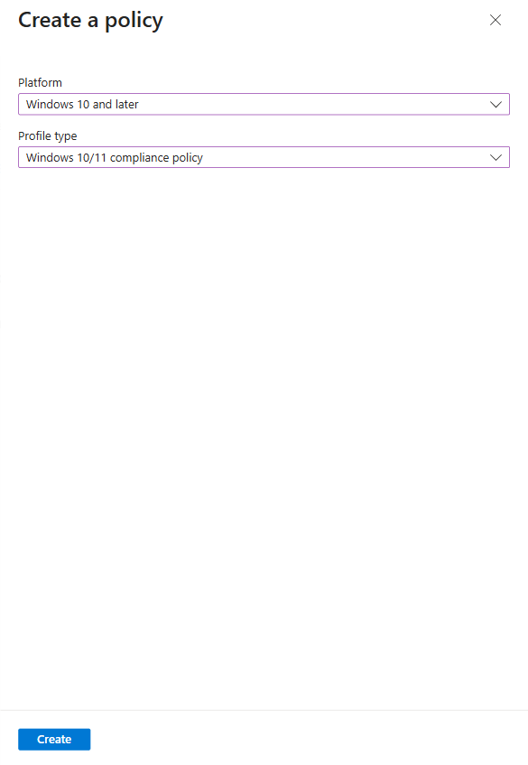
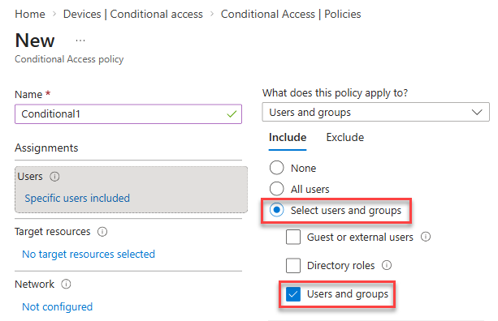

# Lab 17 - Configuring and validating device compliance

### Summary

In this lab, you validate device compliance by configuring a compliance policy and an associated Conditional Access policy that uses the compliance status of a managed device to allow or block access to email.

### Prerequisites

Your lab environment provides **LabVM** (admin workstation, not joined to Microsoft Entra ID), **TestVM** (Windows 11) and **Demo User 01**, a user licensed for Microsoft Intune, Microsoft Entra ID P1 and Exchange Online. Its **User 01 UPN** and **User 01 Password** (a Temporary Access Pass) are on the **Environment** tab.

Nothing else exists yet. Complete **Exercise 0** first: it turns off security defaults, turns on automatic Intune enrolment, creates the **Windows Devices** group, and joins **TestVM** to Microsoft Entra ID and enrolls it in Intune.

## Exercise 0: Prepare the environment

### Task 1: Turn off security defaults

A new tenant has security defaults turned on, and Microsoft Entra ID will not let you enable a Conditional Access policy until they are off.

1. On **LabVM**, open **Microsoft Edge**, go to **https://entra.microsoft.com**, and sign in if asked.

2. Select **Entra ID** > **Overview**, select the **Properties** tab, and select **Manage security defaults**.

3. Set **Security defaults** to **Disabled**, select **My organization is using Conditional Access** as the reason, and select **Save**.

### Task 2: Turn on automatic Intune enrolment

A new tenant does not enroll Windows devices automatically, so a device that joins Microsoft Entra ID would not appear in Intune.

1. In the Microsoft Entra admin center (**https://entra.microsoft.com**), select **Entra ID** > **Mobility**, and then select **Microsoft Intune**.

2. Set **MDM user scope** to **All**, leave the other settings unchanged, and select **Save**.

### Task 3: Create the Windows Devices group

1. In the Microsoft Intune admin center, select **Groups**, and then **New group**.

2. Provide the following values:

    - Group type: **Security**
    - Group name: **Windows Devices**
    - Membership type: **Dynamic Device**

3. Under **Dynamic Device Members**, select **Add dynamic query**. In **Rule syntax**, select **Edit**, enter the following rule, select **OK**, and then select **Save**:

    ```text
    (device.deviceOSType -contains "Windows")
    ```

4. Select **Create** and confirm that **Windows Devices** appears in **Groups | All groups**. Select **Refresh** if it is not listed yet.

### Task 4: Join TestVM to Microsoft Entra ID and enroll it in Intune

**TestVM** has no connect button on the **Resources** tab. You open it with Remote Desktop from **LabVM**.

1. On **LabVM**, select **Start**, type **mstsc**, and press **Enter**.

2. In **Computer**, enter the **TestVM Private IP** from the **Environment** tab, and select **Connect**.

3. Enter the **LabVM Admin Username** and **LabVM Admin Password** from the **Environment** tab. If a certificate warning appears, select **Yes**.

    > **Note:** The first time you sign in to **TestVM**, Windows 11 shows its privacy settings. Select **Next** until the desktop appears.

4. On **TestVM**, select **Start** > **Settings** > **Accounts** > **Access work or school**, and select **Connect**.

5. In the **Microsoft account** window, select **Join this device to Microsoft Entra ID**.

6. Enter the **User 01 UPN** from the **Environment** tab and select **Next**. When it asks for a **Temporary Access Pass**, enter the value shown as **User 01 Password** on the **Environment** tab. Do not select **Use your password instead**.

7. When **Make sure this is your organization** appears, select **Join**, and then **Done**.

8. Select **Start**, type **Access work or school**, and press **Enter**. Select **Enroll only in device management**, enter the **User 01 UPN**, and enter the value shown as **User 01 Password** where **Enter Temporary Access Pass** is asked. Complete the prompts.

    > **Note:** Do not sign out of **TestVM** now: signing out closes the Remote Desktop window. If the device does not appear in Intune, restart **TestVM** from the **Resources** tab and repeat this step.

9. In the **Microsoft Intune admin center**, select **Devices** > **All devices** and confirm that **TestVM** is listed. The first compliance evaluation takes about 10 minutes, so continue with **Exercise 1** now.

## Exercise 1: Configuring compliance policies

### Scenario

Contoso would like to ensure that Windows devices that are enrolled in Microsoft Intune meet a minimum configuration specification. The following specifications are required:

- Minimum Windows operating system version: **10.0.19041.329**
- Microsoft Defender Antimalware: **Required**

If a device meets these requirements, it will be marked as compliant. If the device does not meet these requirements, the device should be marked as noncompliant.

### Task 1: Create and assign a compliance policy

1. On **LabVM**, you are already signed in. Open **Microsoft Edge**.

2. On the taskbar, select **Microsoft Edge**. In Microsoft Edge, type **https://intune.microsoft.com** in the address bar, and then press **Enter**.

3. Sign in with the **Username** and **Temporary Access Pass** from the **Environment** tab. If you are already signed in, continue with the next step.

    

4. From the navigation pane, select **Devices**, then select **Compliance** under **Manage devices**.

    

5. On the **Compliance | Policies** blade, in the details pane, select **+ Create policy**.

    

6. On the **Create a policy** blade, provide the following values and select **Create**:

    - Platform: **Windows 10 and later**
    - Profile type: **Windows 10/11 compliance policy**

    

7. On the **Basics** tab, provide the following value and select **Next**:

    - Name: **Compliance1**

    

8. On the **Compliance settings** tab, expand **Device Health** and review the available settings.

    

9. On the **Compliance settings** tab, expand **Device Properties**. In the **Minimum OS version** field, type **10.0.19041.329**.

    

10. On the **Compliance settings** tab, expand **System Security**. Set the **Microsoft Defender Antimalware** setting to **Require** and then select **Next**.

    

11. On the **Actions for noncompliance** tab, note that the default action **Mark device noncompliant** is set to **Immediately**.

    

    Review how you can configure the number of days after which the device is marked as noncompliant, and configure additional actions.

12. Select **Next**. On the **Assignments** tab, select **Add groups**. Select **Windows Devices**, choose **Select**, and then select **Next**.

    

    > **Note:** The **Windows Devices** dynamic group was created in Lab 6 and automatically includes TestVM.

13. Select **Create**.

    

14. In the navigation menu, select **Devices**, and then in the Devices navigation pane, select **Compliance**.

    

15. On the **Compliance** page, select **Compliance settings**.

    

16. On the **Compliance policy settings** page, next to **Mark devices with no compliance policy assigned as**, select **Not compliant** and then select **Save**.

    

    This setting ensures that any device that does not have a compliance policy assigned will be set to **Not compliant**.

### Task 2: Evaluate compliance on TestVM

Before you enforce compliance with Conditional Access, confirm that TestVM has been evaluated as compliant.

1. Switch to **TestVM** and sign in as **Demo User 01** with the PIN **102938**.

2. Select **Start** → **Settings** → **Accounts** → **Access work or school**. Select **Connected to your organization's Microsoft Entra ID** → **Info**, scroll down, and select **Sync**.

3. Switch to **LabVM**. In the **Microsoft Intune admin center**, select **Devices** → **All devices**.

4. Find **TestVM** and verify that the **Compliance** column shows **Compliant**.

    > **Note:** The first compliance evaluation can take 10–15 minutes. If TestVM shows **Not evaluated** or **In grace period**, wait a few minutes, select **Refresh**, and check again. Do not continue to Exercise 2 until TestVM shows **Compliant**, or Demo User 01 will be blocked on TestVM too.

**Results**: After completing this exercise, you will have successfully configured a compliance policy and verified that TestVM is compliant.

## Exercise 2: Creating a Conditional Access policy to enforce compliance

### Scenario

When a user uses a device that is not marked as compliant, they should not be able to access their email. You've been asked to configure a Conditional Access policy that enforces this rule, and verify that it functions as expected.

### Task 1: Create a Conditional Access policy

1. On **LabVM**, in the **Microsoft Intune admin center**, select **Devices**, then select **Conditional access**.

    

2. Select **Policies**, then select **+ New policy**.

    

3. On the **New** blade, in the **Name** text box, type **Conditional1**, and then select **0 users and groups selected**.

    

4. On the **Include** tab, select **Select users and groups**, select the **Users and groups** check box, search for and select **Demo User 01**, and then choose **Select**.

    

    > **Note:** The policy targets only Demo User 01 so that it cannot lock the tenant admin or other lab users out of Exchange Online.

5. On the **New** blade, select **No target resources selected**, select the **Select resources** radio button. Under **Select specific resources**, select **None**, select **Office 365 Exchange Online**, and then click **Select**.

    

6. On the **New** blade, in the **Conditions** section, select **0 conditions selected**.

    

7. In the list of conditions, under **Device platforms**, select **Not configured**. Set **Configure** to **Yes**, select the **Select device platforms** radio button, select the **Windows** check box, and then select **Done**.

    

8. On the **New** blade, under **Access controls**, in the **Grant** section, select **0 controls selected**.

9. Select **Grant access**, select the **Require device to be marked as compliant** check box, and then select **Select**.

    

10. On the **New** blade, set **Enable policy** to **On** and then select **Create**.

    > **Note:** If you see **Security defaults must be disabled to enable Conditional Access policy**, complete **Exercise 0, Task 1** first.

    

    > **Note:** Allow about 5 minutes for the new policy to take effect before testing.

### Task 2: Verify that access is blocked from an unmanaged device

LabVM is a Windows device that is **not** enrolled in Intune, so it has no compliance status. You use it to test what happens when Demo User 01 signs in from an unmanaged device.

1. On **LabVM**, in Microsoft Edge, press **Ctrl+Shift+N** to open an **InPrivate** window.

2. In the InPrivate window, go to **https://outlook.office.com**.

3. Sign in as the **User 01 UPN** from the **Environment** tab, and enter the value shown as **User 01 Password** where **Enter Temporary Access Pass** is asked.

    

4. Verify that access is blocked, and that you receive a message that the device does not meet your organization's requirements, such as **You can't get there from here**.

    

5. Select **More details**. You should see more information about why you are blocked.

    

    > **Note:** Demo User 01 is blocked because LabVM is not joined to Microsoft Entra ID and not managed by Microsoft Intune, so it is not marked as compliant.

6. Close the InPrivate window.

### Task 3: Verify that access is allowed from a compliant device

1. Switch to **TestVM**, which is still connected through Remote Desktop.

    > **Note:** TestVM is a managed Windows 11 device that is enrolled in Intune and marked as compliant.

2. On the taskbar, select **Microsoft Edge**. In Microsoft Edge, type **https://outlook.office.com** and then press **Enter**.

3. If prompted, sign in as the **User 01 UPN** from the **Environment** tab. Verify that you can access Demo User 01's mailbox.

    

    > **Note:** Demo User 01 is allowed because **TestVM** is a managed device that is marked as compliant.

4. Close Microsoft Edge and sign out of **TestVM**.

### Task 4: Disable the Conditional Access policy

1. On **LabVM**, in the **Microsoft Intune admin center**, select **Devices**, then select **All devices**.

    

    Notice that **TestVM** is compliant, which is why Demo User 01 was allowed to access her mailbox.

2. From the navigation pane, select **Devices**, then select **Conditional access**.

    

3. On the **Conditional Access** page, select **Policies**, then select **Conditional1**.

    

4. On the **Conditional1** page, at the bottom of the page, select **Off** and then select **Save**.

    

5. Close Microsoft Edge.

**Results**: After completing this exercise, you will have successfully configured a Conditional Access policy that uses device compliance to control access to email.
