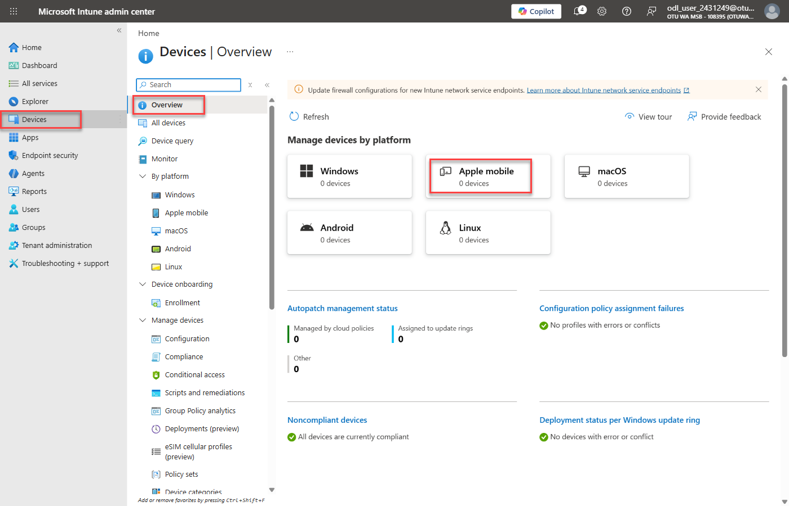
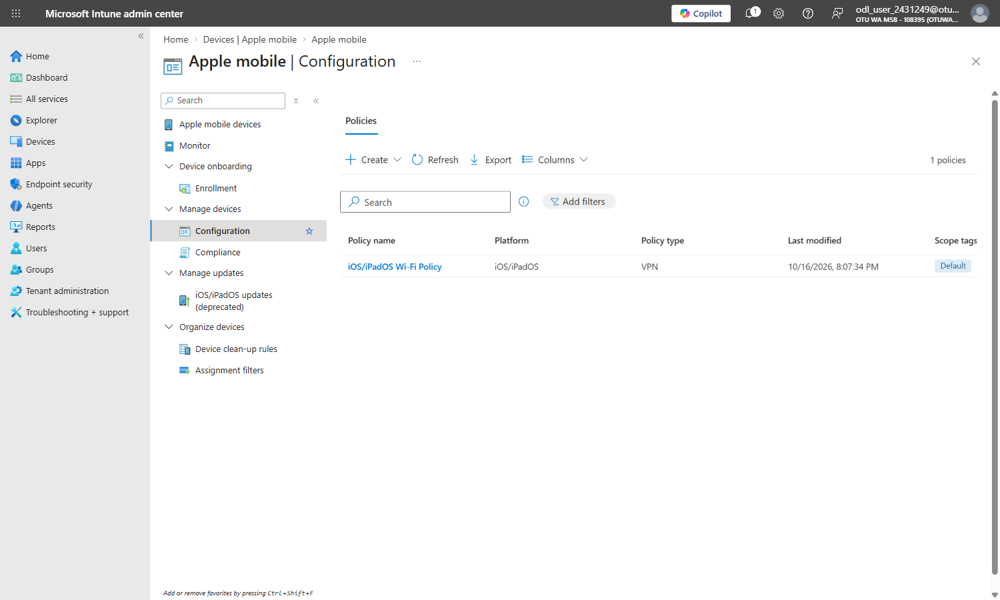

# Lab 20 - Configure VPN Policies for iOS Devices

### Summary

In this lab, you create a VPN configuration profile that uses Microsoft Tunnel and assign it to enrolled iOS and iPadOS devices.

### Prerequisites

The following lab must be completed before this lab:

- Lab #19-Configure VPN Policies for Android Devices *(creates the **Contoso secure access site** that this profile uses)*

> **Note:** As in Lab 19, this lab creates and assigns the configuration only. No iOS or iPadOS device is enrolled in this lab environment.

## Exercise 1: Create a VPN configuration profile for iOS and iPadOS

### Scenario

You have been asked to create a configuration profile that sets up VPN for enrolled iOS and iPadOS devices through Microsoft Tunnel.

### Task 1: Create the iOS_iPadOS Devices group

1. On **LabVM**, in the **Microsoft Intune admin center** (**https://intune.microsoft.com**), select **Groups**, and then select **New group**.

    

2. On the **New Group** blade, enter the following information and select **Create**:

    - Group type: **Security**
    - Group name: **iOS_iPadOS Devices**
    - Group description: **All iOS and iPadOS devices**
    - Membership type: **Assigned**

    

3. On the **Groups | All groups** blade, select **Refresh** and verify that the **iOS_iPadOS Devices** group is displayed.

    

### Task 2: Create a configuration profile

1. In the **Microsoft Intune admin center**, select **Devices**.

    

2. Under **By platform**, select **Apple mobile**.

3. Under **Manage devices**, select **Configuration**.

    

4. On the **Apple mobile | Configuration** page, on the **Policies** tab, select **Create**, and then select **New Policy**.

    

5. In the **Create a profile** blade, select the following options, and then select **Create**:

    - Platform: **iOS/iPadOS**
    - Profile type: **Templates**
    - Template name: **VPN**

    

6. On the **Basics** tab, enter the following information, and then select **Next**:

    - Name: **iOS/iPadOS VPN Policy**
    - Description: **VPN settings for iOS/iPadOS devices**

    

7. On the **Configuration settings** tab, next to **Connection type**, select **Microsoft Tunnel**.

    Additional options display based on the type selected.

8. Expand **Base VPN**, and enter the following information:

    - Connection name: **Contoso VPN**
    - Microsoft Tunnel site: select **Select a site**, select **Contoso secure access site**, and then select **OK**

    Select **Next**.

    

9. On the **Assignments** tab, under **Included groups**, select **Add groups**.

    

10. In the **Select groups to include** window, select **iOS_iPadOS Devices**, and then select **Select**.

    > **Note:** Check the **Selected** list before you select **Select**. The list can still contain a group you chose earlier in the portal session. Remove any group other than **iOS_iPadOS Devices**.

    

11. On the **Assignments** tab, select **Next**.

    

12. On the **Review + create** tab, select **Create**.

    

13. On the **Apple mobile | Configuration** page, select **Refresh**, and verify that **iOS/iPadOS VPN Policy** is listed.

    

**Results**: After completing this exercise, you will have created and assigned a VPN configuration profile for iOS and iPadOS devices that uses Microsoft Tunnel.
