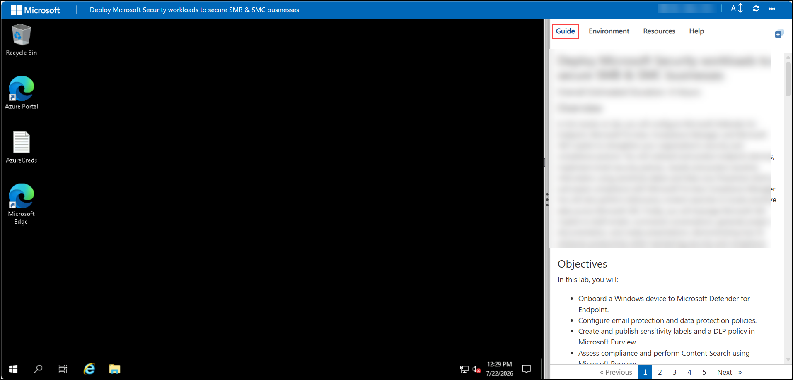
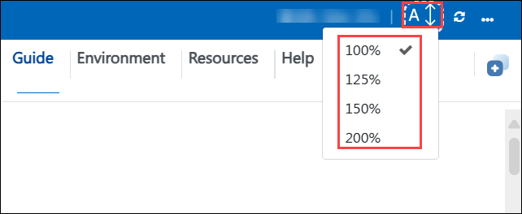
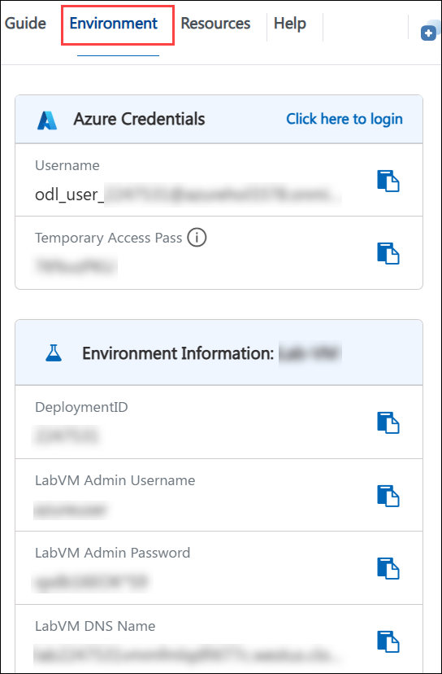
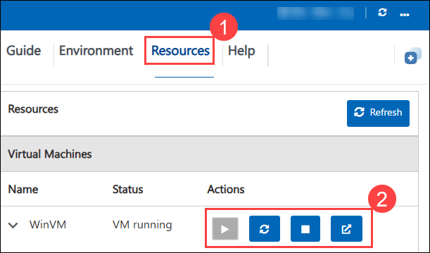
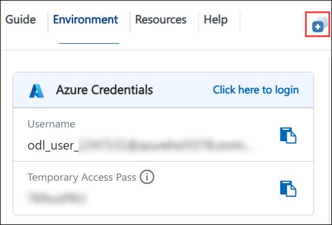
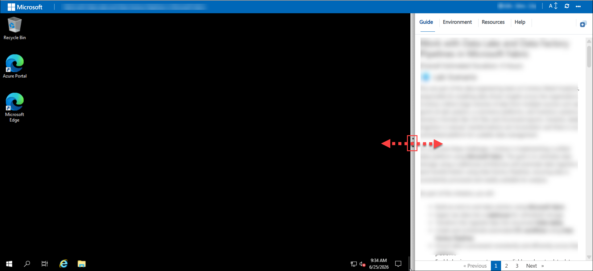

# Day 3 – Intune Suite, AI Integration and Advanced Analytics

### Overall Estimated Duration: 4 Hours

## Overview  

In this hands-on lab, you will work with the advanced capabilities of the Microsoft Intune Suite and bring AI into endpoint management. You will configure Enterprise Application Management (EAM) to deploy and update apps at scale, and enable Remote Help so your helpdesk can securely assist users. You will then monitor device performance and user experience with Endpoint Analytics, and use Advanced Analytics and reporting to proactively find issues with device queries. Finally, you can optionally explore Copilot in Intune to analyze policies and troubleshoot devices using natural language.

## Objectives

In this lab, you will:
 
- Configure Enterprise Application Management (EAM) and deploy apps from the Enterprise App Catalog.
- Enable Remote Help and start a secure remote assistance session.
- Monitor device performance and user experience with Endpoint Analytics.
- Use Advanced Analytics and reporting in Intune, including device queries.
- Explore Copilot in Intune to summarize policies and troubleshoot devices (optional).

## Pre-requisites

Participants should have:

- Completion of Day 1 and Day 2, with devices enrolled and reporting to Intune.
- Awareness of Microsoft Intune Suite capabilities and licensing.
- Basic familiarity with Kusto Query Language (KQL) for device queries.
- Understanding of Intune role-based access control and scope tags.

## Architecture

This architecture demonstrates an end-to-end workflow for AI-assisted endpoint operations. Apps are deployed and kept up to date from the Enterprise App Catalog, while Remote Help provides secure helpdesk assistance with role-based permissions. Endpoint Analytics and Advanced Analytics collect device performance and health data, which administrators query and report on. Copilot in Intune uses this data to help administrators understand configurations and resolve issues faster.

## Explanation of Components

The architecture for this lab involves the following key components:

- **Endpoint:** Represents the Intune-managed Windows device that receives apps and reports performance and health data.

- **Microsoft Intune Suite:** A set of premium capabilities built on Intune, including EAM, Remote Help, Advanced Analytics, and EPM.

- **Enterprise Application Management (EAM):** Provides an Enterprise App Catalog of pre-packaged apps that can be deployed and updated at scale.

- **Remote Help:** A secure cloud-based helpdesk tool for viewing or controlling a user's device with role-based permissions.

- **Endpoint Analytics:** Measures startup performance, application reliability, and user experience, and recommends improvements.

- **Advanced Analytics:** Adds device queries, anomaly detection, battery health, and an enhanced device timeline.

- **Device Query:** Runs KQL queries against live device data to quickly investigate and troubleshoot endpoints.

- **Copilot in Intune:** A generative AI assistant in the Intune admin center that helps summarize policies, compare devices, and troubleshoot.

## Accessing Your Lab Environment
Once you're ready to dive in, your virtual machine and **Guide** will be right at your fingertips within your web browser.

## Virtual Machine & Lab Guide
Your virtual machine is your workhorse throughout the workshop. The guide is your roadmap to success.

## Lab Guide Zoom In/Zoom Out

To adjust the zoom level for the environment page, click the **A↕ : 100%** icon located next to the timer in the lab environment.

## Exploring Your Lab Resources
To get a better understanding of your lab resources and credentials, navigate to the **Environment** tab.

## Managing Your Virtual Machine
Feel free to **start, restart, or stop (2)** your virtual machine as needed from the **Resources (1)** tab. Your experience is in your hands!

## Utilizing the Split Window Feature
For convenience, you can open the lab guide in a separate window by selecting the **Split Window** button from the top right corner.

## Resize the Virtual Machine View

Use the **slider (three vertical dots)** located between the **Virtual Machine** and the **Lab Guide** panes to adjust the display size, allowing you to customize the layout based on your preference.

## Support Contact

The CloudLabs support team is available 24/7, 365 days a year, via email and live chat to ensure seamless assistance at any time. We offer dedicated support channels tailored specifically for both learners and instructors, ensuring that all your needs are promptly and efficiently addressed.

Learner Support Contacts:

- Email Support: cloudlabs-support@spektrasystems.com
- Live Chat Support: https://cloudlabs.ai/labs-support

Click **Next >>** from the bottom right corner to embark on your Lab journey!

### Happy Learning!!
